<p align="center">
  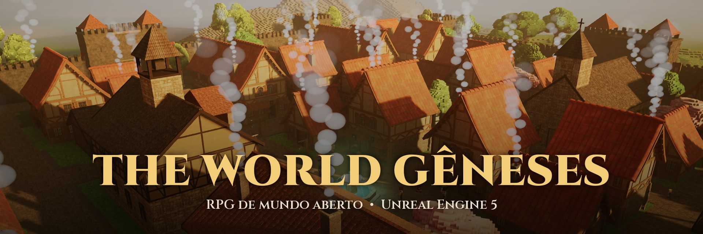
</p>

<p align="center">
  
  
  
  
  
  
</p>

<p align="center">
  <b>Um RPG de mundo aberto em blocos, para jogar sozinho ou com amigos:</b><br>
  explorar nove regiões • lutar com espada, arco e magia • viver nas vilas • enfrentar os chefes
</p>

---

## Trailer

<p align="center">
  <a href="Docs/Github/trailer.mp4">
    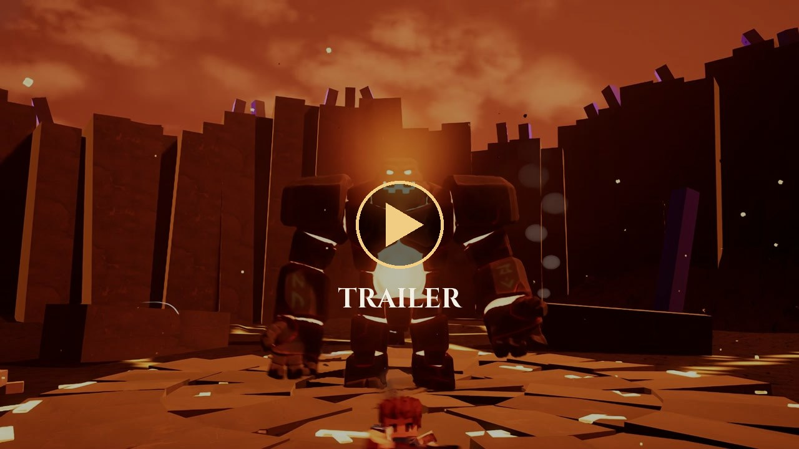
  </a>
  <br>
  <sub>▶ Clique na imagem para assistir ao trailer (1:14). Tudo gravado dentro do jogo e montado no FilmCraft, no ritmo de "The Hero's Journey".</sub>
</p>

---

## Sumário

- [Trailer](#trailer)
- [O jogo](#o-jogo)
- [Galeria](#galeria)
- [O que já tem](#o-que-já-tem)
- [Tecnologias e arquitetura](#tecnologias-e-arquitetura)
- [Ferramentas próprias](#ferramentas-próprias)
- [Como está organizado](#como-está-organizado)
- [Privacidade e segurança](#privacidade-e-segurança)
- [Próximos passos](#próximos-passos)
- [Licença](#licença)

---

## O jogo

**The World Gêneses** é um RPG de ação em mundo aberto feito em blocos. Você cria o seu herói, escolhe uma das seis
raças e sai pelo vale de Gênese: campos, vulcões, picos gelados, pântanos e florestas, cada região com o seu relevo,
os seus monstros e os seus segredos.

O jogo nasceu no Godot e está sendo migrado para a **Unreal Engine 5.8 em C++**, com multiplayer de verdade (o
servidor decide o dano), mundo gerado por pedaços que carregam em volta dos jogadores e vilas com moradores que têm
rotina.

| | |
|---|---|
| 🌍 **9 regiões** com relevo próprio, rios e 6 lugares marcantes | 🧝 **6 raças** jogáveis, com criação de herói |
| ⚔️ **35 espadas, 35 arcos e 21 armaduras** | 🐺 Lobos, matilhas, bandidos e **chefes com fases** |
| 🌦️ Dia e noite, lua, **clima e estações** | 🏘️ Vilas vivas: moradores, ofícios, animais e lojas |
| 👥 **Multiplayer online** com salas e código de convite | 🐎 Montaria, coleta e alquimia |

<sub>Números do projeto: 252 arquivos C++ (~74 mil linhas), 267 scripts de ferramentas e 75 arquivos de dados.</sub>

---

## Galeria

### A vila

<table>
  <tr>
    <td width="50%">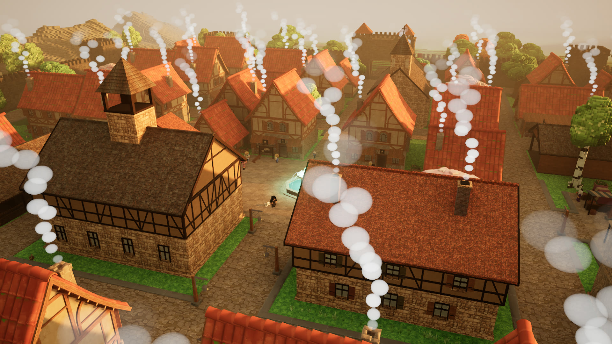<br><sub><b>A vila do alto</b> — casas de enxaimel, a muralha e as montanhas ao fundo</sub></td>
    <td width="50%">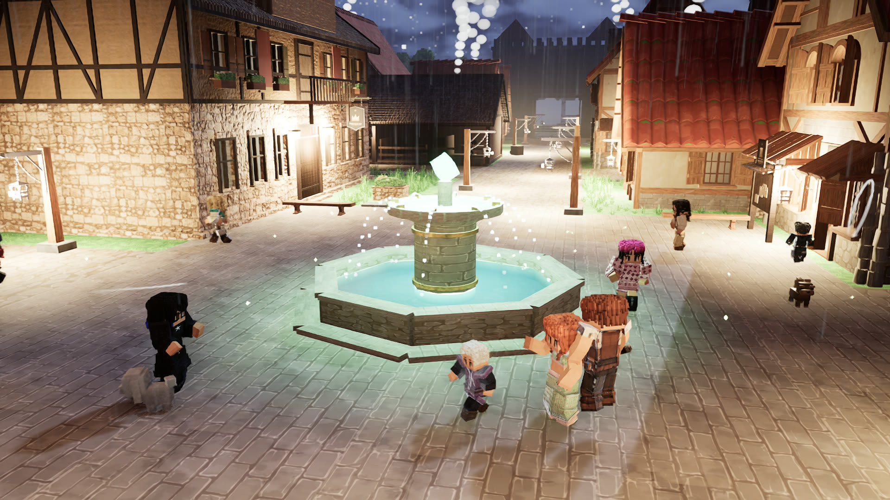<br><sub><b>A praça à noite</b> — chuva, lamparinas e os moradores em volta da fonte</sub></td>
  </tr>
  <tr>
    <td>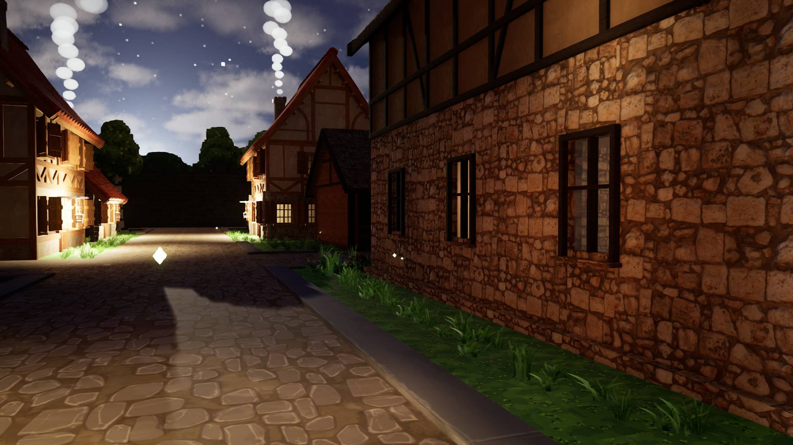<br><sub><b>As ruas</b> — pedra, luz nas janelas e o céu estrelado</sub></td>
    <td></td>
  </tr>
</table>

### Criar o herói

<table>
  <tr>
    <td width="50%">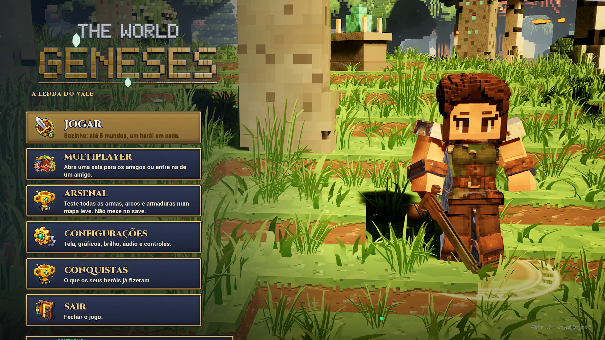<br><sub><b>Menu inicial</b> — com o herói no palco 3D</sub></td>
    <td width="50%">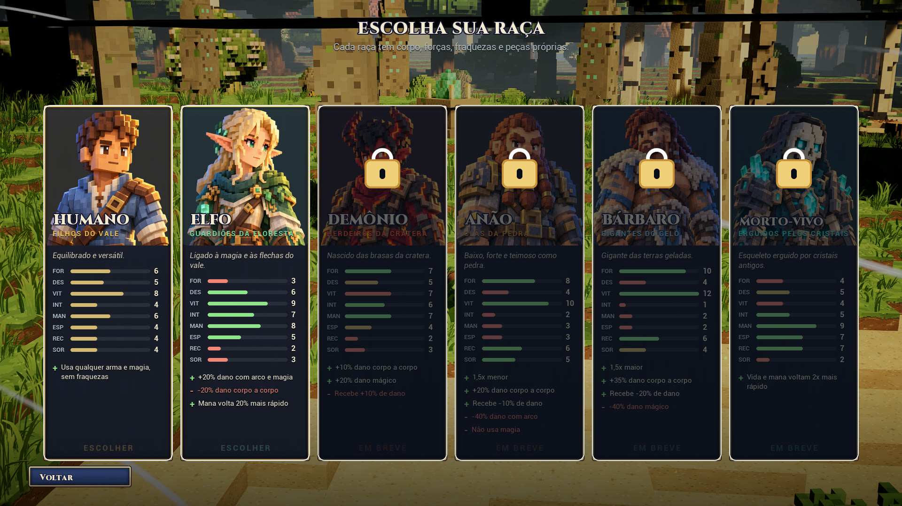<br><sub><b>Escolha da raça</b> — humano, elfo, demônio, anão, bárbaro e morto-vivo</sub></td>
  </tr>
  <tr>
    <td>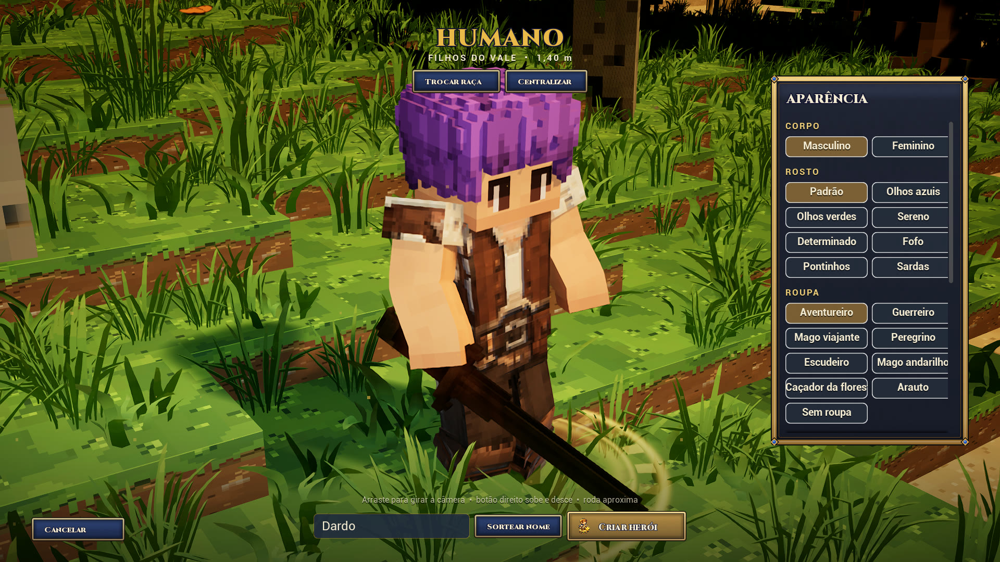<br><sub><b>Criação do herói</b> — corpo, rosto, cabelo e roupa</sub></td>
    <td>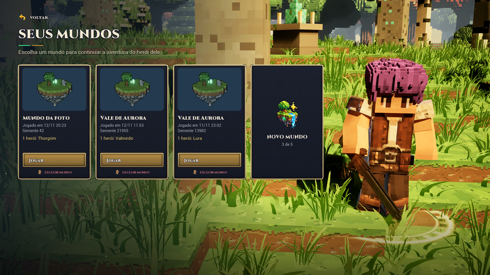<br><sub><b>Seus mundos</b> — cada mundo salvo com os seus heróis</sub></td>
  </tr>
</table>

### Aventura e combate

<table>
  <tr>
    <td width="50%">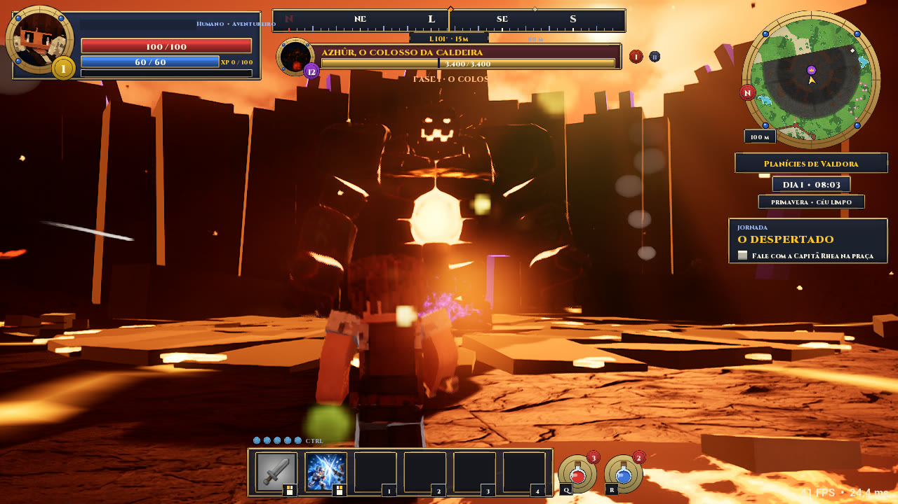<br><sub><b>Azhûr desperta</b> — o colosso da Caldeira, com céu vermelho e poças de lava</sub></td>
    <td width="50%">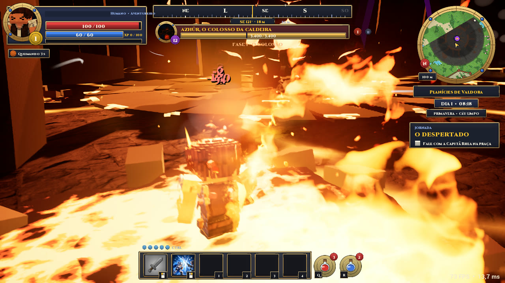<br><sub><b>Erupção</b> — uma das habilidades do chefe, em várias fases</sub></td>
  </tr>
  <tr>
    <td>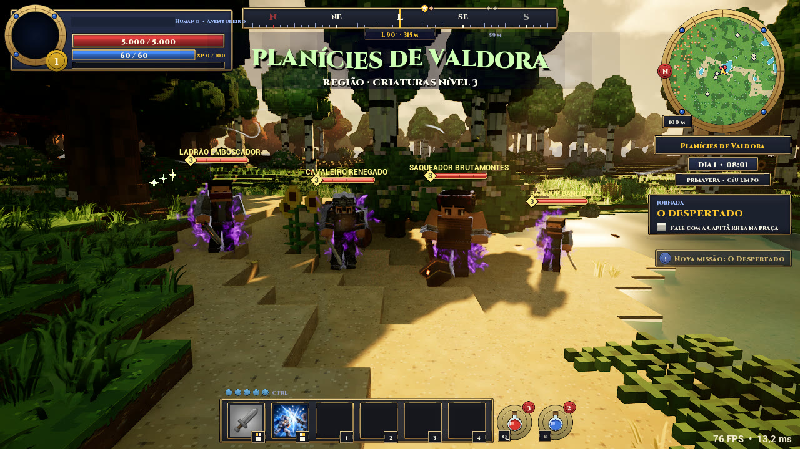<br><sub><b>Bandidos</b> — ladrão, cavaleiro renegado e saqueador nas Planícies de Valdora</sub></td>
    <td>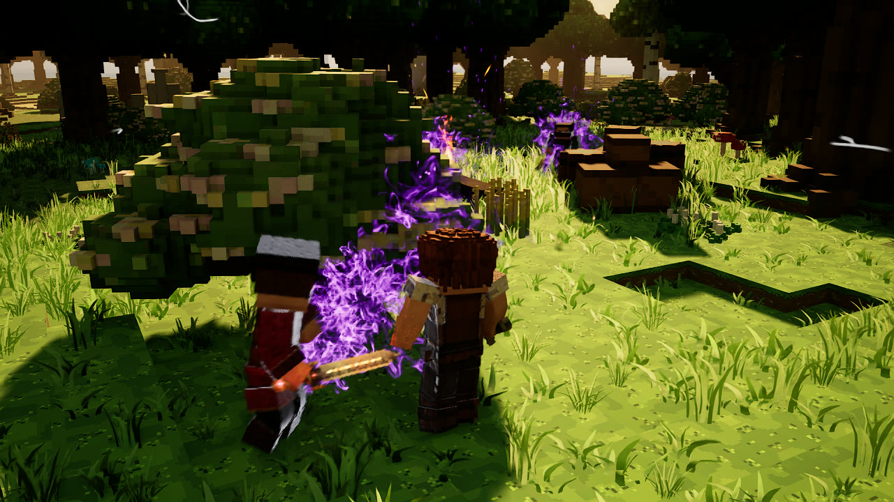<br><sub><b>O acampamento</b> — os bandidos guardam o baú no meio da floresta</sub></td>
  </tr>
</table>

---

## O que já tem

**Mundo**
- **Regiões:** Planícies de Valdora, Brasafenda, Picos de Raikor, Nivaluz, Solcânion, Aurivale, Lodonegro, Morthúria
  e Verdalume. O relevo é gerado com erosão e rios que serpenteiam.
- **Lugares marcantes:** a Árvore do Mundo, com raízes que viram caminhos, e mais cinco pontos para descobrir.
- **Céu vivo:** dia e noite com lua em fases e estrelas; chuva, tempestade, neve, nevasca e neblina; quatro estações.
- **Natureza:** grama e árvores que balançam com o vento, folhas caindo de cada tipo de árvore e rastros de vento no ar.

**Vilas**
- Moradores com rotina, ofícios e voz; lojistas atrás do balcão; animais andando pela vila.
- Casas de um kit medieval, com interiores, escadas e a forja do ferreiro.

**Combate e RPG**
- Sistema de habilidades (Gameplay Ability System) com o dano decidido no servidor.
- Espada com combo de 3 golpes, defesa e defesa perfeita; arcos; magias; esquiva.
- Classes escolhidas no nível 10 (o Despertar), cada uma com as suas habilidades.
- Inimigos: lobos que caçam em matilha, bandidos com acampamento e o chefe **Azhûr, o golem vulcânico**.
- Mochila, equipamentos, missões, alquimia, saque no chão e economia com lojas.

**Multiplayer**
- Salas online pela Epic Online Services, com código para entrar no mundo de um amigo.
- O mundo, os monstros e o terreno carregam em volta de cada jogador.

---

## Tecnologias e arquitetura

O código fica em quatro módulos em camadas. Um módulo de baixo nunca inclui o de cima: o que ele precisa vai por
ganchos.

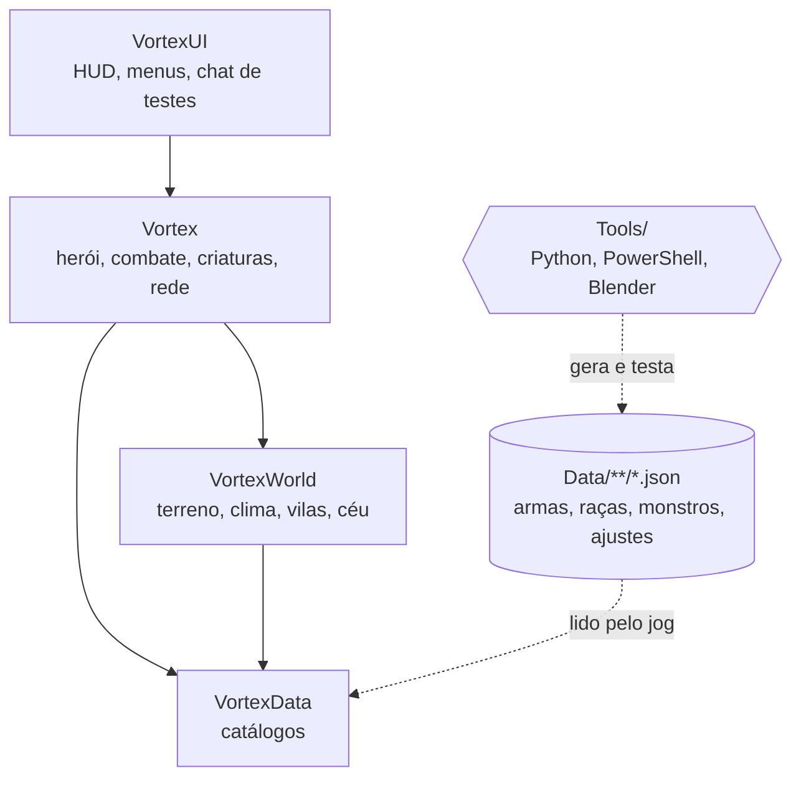

| Camada | Tecnologia |
|---|---|
| Motor | Unreal Engine 5.8, C++ |
| Combate | Gameplay Ability System, dano decidido no servidor |
| Rede | Replicação da Unreal e Epic Online Services (salas e convites) |
| Mundo | Terreno gerado em pedaços (streaming), relevo por região, instâncias para grama e árvores |
| Dados | JSON lidos pelo jogo: ajustar números não precisa compilar |
| Arte | Blender (modelagem e animação), kits de modelos, texturas próprias |
| Testes | Testes automáticos que abrem o jogo sem janela, jogam e tiram fotos |

---

## Ferramentas próprias

Boa parte do trabalho é feita por scripts, para que tudo possa ser refeito e testado sem clicar no editor:

- **Testes de verdade:** scripts `Tools/Run*.ps1` abrem o jogo escondido, jogam um trecho (combate, lobo, matilha,
  rede, salvamento) e conferem o resultado. As fotos saem em `Saved/Screenshots`.
- **Desempenho:** um passeio a galope mede o FPS, o pior 1% e o que trava (`RunRoamBench.ps1`).
- **Vídeo:** um modo filme lê as tomadas de um JSON (`Data/Film`): câmera que gira, sobe ou segue o chefe e o cavalo,
  herói lutando sozinho, clima e hora. Ele salva cada quadro (`RecordFilm.ps1`, `RecordGameplay.ps1`). O trailer acima saiu dele.
- **Arte:** scripts do Blender montam as casas, as armas e as animações (`Tools/Blender`).
- **Chat de testes:** dentro do jogo, a tecla T abre comandos como `/clima tempestade`, `/noite` e `/spawn lobo`
  ([lista](Docs/COMANDOS_DE_TESTE.md)).

---

## Como está organizado

```
the-world-genese/
├── Source/          o código C++ (VortexUI, Vortex, VortexWorld, VortexData)
├── Config/          a configuração da Unreal
├── Data/            os JSON do jogo: armas, raças, monstros, mundo, ajustes
├── Tools/           scripts de teste, de importação e do Blender
└── Docs/            o diário do projeto, por fase, e as imagens deste README
```

Este repositório guarda **o código, os dados e a documentação**. A arte pesada (modelos, texturas, sons e mapas, mais
de 10 GB) fica fora dele, então o projeto não abre sozinho a partir daqui.

---

## Privacidade e segurança

- Nenhuma chave, senha ou credencial está no repositório: o arquivo de credenciais online fica fora (veja o
  [`.gitignore`](.gitignore)).
- As imagens e o trailer foram gravados dentro do jogo, com personagens de teste.
- A arte e os arquivos de terceiros não são publicados aqui.

---

## Próximos passos

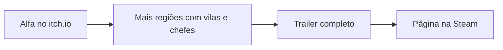

- [ ] Refazer os prédios grandes e a muralha com o kit novo
- [ ] Corrigir os detalhes da forja do ferreiro
- [ ] Um chefe para cada região
- [ ] Trailer completo com combate e exploração
- [ ] Página na Steam

---

## Licença

**Todos os direitos reservados.** Este é um projeto proprietário: o código, a arte, a história e o mundo de The World
Gêneses não podem ser copiados, modificados nem usados em outros projetos sem autorização por escrito. Veja o
arquivo [LICENSE](LICENSE).

<p align="center"><sub>The World Gêneses © 2025-2026 Eros Nicolino. Feito com Unreal Engine.</sub></p>
